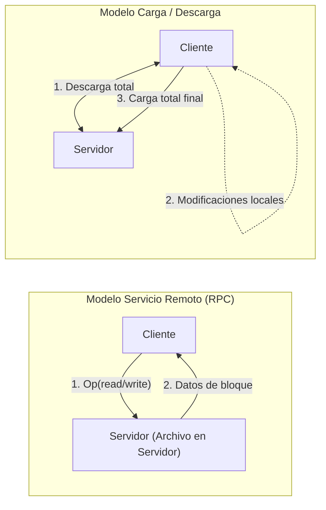

# 🧭 Cheatsheet: Sistema de Archivos Distribuido (DFS) y RPC en GNU/Linux

> **Cátedra:** Sistemas Operativos II — Ciclo Lectivo 2026  
> **Universidad Nacional de Jujuy (UNJu) — Facultad de Ingeniería**  
> **Unidad Temática N° 6:** Sistema de Archivos Distribuido (DFS)  

---

## 🗄️ 1. Conceptos Fundamentales de DFS

* **Servicio de Archivos:** Especificación formal de las operaciones sobre archivos (primitivas, argumentos y resultados) ofrecidas a los clientes sin revelar detalles internos de implementación.
* **Servidor de Archivos:** Proceso de usuario (o de núcleo) que ejecuta la implementación concreta del servicio de archivos en un nodo físico o máquina virtual.
* **Cliente:** Proceso que invoca operaciones del servicio de archivos a través de una interfaz de cliente.
* **Unidad Componente:** Conjunto mínimo de archivos que puede almacenarse y gestionarse localmente.
* **Rendimiento de un DFS:** Función de:
  $$T_{\text{total}} = T_{\text{acceso\_disco}} + T_{\text{proceso}} + T_{\text{envío\_solicitud}} + T_{\text{respuesta\_red}} + \text{Costo}_{\text{CPU\_comunicación}}$$

---

## 🏷️ 2. Nombrado y Transparencia

| Esquema de Nombrado | Transparencia de Ubicación | Independencia de Ubicación | Ejemplo Tecnológico |
| :--- | :---: | :---: | :--- |
| **Host + Ruta Local** (`host:/ruta`) | ❌ No | ❌ No | SCP / RCP / FTP primitivo |
| **Asociación de Directorios Remotos (Montaje)** | ✅ Sí (estática) | ❌ No (rutas fijas por host) | NFS (Network File System) |
| **Estructura Única Global de Nombres** | ✅ Sí | ✅ Sí (soporta migración libre) | AFS (Andrew File System) |

---

## 🔌 3. Diagnóstico de RPC y Servicios Portmapper en Linux

```bash
# Consultar todos los programas RPC registrados en el portmapper local
rpcinfo -p

# Consultar servicios RPC en un servidor remoto específico
rpcinfo -p 192.168.1.50

# Verificar registro del servicio NFS (programa RPC 100003)
rpcinfo -u localhost 100003 3

# Comprobar el estado del demonio rpcbind / portmap
systemctl status rpcbind
```

---

## 📁 4. Administración y Montaje de NFS en GNU/Linux

```bash
# Ver directorios exportados por un servidor NFS remoto
showmount -e 192.168.1.50

# Montar un recurso compartido NFS en un directorio local
sudo mount -t nfs 192.168.1.50:/srv/nfs/compartido /mnt/nfs_punto

# Montar con política síncrona (Write-Through - máxima fiabilidad)
sudo mount -t nfs -o sync 192.168.1.50:/srv/nfs /mnt/nfs_punto

# Montar con política asíncrona (Write-Back diferida - velocidad)
sudo mount -t nfs -o async 192.168.1.50:/srv/nfs /mnt/nfs_punto

# Configurar tiempos de validez de caché de atributos (actimeo en segundos)
sudo mount -t nfs -o actimeo=30 192.168.1.50:/srv/nfs /mnt/nfs_punto

# Exportar directorios en el servidor (/etc/exports)
# /srv/nfs/compartido 192.168.1.0/24(rw,sync,no_subtree_check)
sudo exportfs -rav
sudo exportfs -v

# Estadísticas de llamadas RPC y caché en NFS
nfsstat -c   # Estadísticas del cliente
nfsstat -s   # Estadísticas del servidor
```

---

## ⚡ 5. Modelos de Acceso: Servicio Remoto (RPC) vs. Carga/Descarga



* **Servicio Remoto:** Óptimo para archivos grandes donde solo se modifica una pequeña fracción. No exige almacenamiento masivo en el cliente.
* **Carga/Descarga:** Óptimo para ciclos de trabajo intensivos donde el cliente realiza cientos de lecturas/escrituras locales consecutivas (ej. compilación).

---

## 💾 6. Políticas de Actualización y Coherencia de Caché

* **Write-Through (Escritura Directa):**
  - Cada `write()` se transmite de inmediato al servidor.
  - **Ventaja:** Máxima fiabilidad, coherencia estricta ante caídas del cliente.
  - **Desventaja:** Rendimiento penalizado severamente por la latencia RTT de la red.
* **Write-Back / Delayed Write (Escritura Diferida):**
  - Las escrituras se almacenan en la caché local y se transmiten más tarde en lote.
  - *Variante 1:* Volcar al expulsar el bloque (política LRU).
  - *Variante 2:* Volcar al cerrar el archivo (Semántica de sesión / Flush on close).
  - **Ventaja:** Escritura a velocidad de bus de memoria, reduce drásticamente el tráfico.
  - **Desventaja:** Riesgo de pérdida de datos si el cliente cae antes del volcado.
* **Coherencia de Caché:**
  - *Iniciada por Cliente (Client-Initiated):* El cliente consulta periódicamente si la copia local sigue siendo válida (`actimeo`).
  - *Iniciada por Servidor (Server-Initiated / Callbacks):* El servidor recuerda quién tiene qué archivo; ante una escritura, emite avisos de invalidación (`break callback`).

---

## 🏛️ 7. Servidores con Estado (Stateful) vs. Sin Estado (Stateless)

| Característica | Servidor con Estado (Stateful) | Servidor sin Estado (Stateless) |
| :--- | :--- | :--- |
| **Información en el Servidor** | Puntero de archivo, bloqueos, tablas de abiertos | Ninguna entre peticiones |
| **Peticiones del Cliente** | Breves (`read(fd, 1024)`) | Autocontenidas (`read(file_handle, offset=4096, len=1024)`) |
| **Tolerancia a Caídas** | Compleja (requiere protocolos de reconstrucción) | Trivial (el cliente reintenta la llamada idempotente) |
| **Bloqueo de Archivos** | Sencillo y nativo en el servidor | Complejo (requiere demonio auxiliar separado, ej. NLM) |
| **Idempotencia** | No requerida para todas las operaciones | Obligatoria (repetir la operación produce el mismo resultado) |

---

## ⚖️ 8. Algoritmo de Voto por Quórum de Gifford (Quorum Consensus)

Dado un sistema con $N$ servidores replicados, cada uno con 1 voto:
* $N_r$: Quórum de Lectura (número mínimo de servidores a consultar para leer).
* $N_w$: Quórum de Escritura (número mínimo de servidores a consultar para escribir).

### Reglas Obligatorias de Consistencia:
1. **Prevención de anomalías Lectura-Escritura (Read-Write Conflicts):**
   $$N_r + N_w > N$$
   *Garantiza que cualquier conjunto de lectura de tamaño $N_r$ contenga al menos un nodo que participó en la última escritura de tamaño $N_w$ (el cliente siempre lee el número de versión más reciente).*
2. **Prevención de anomalías Escritura-Escritura (Write-Write Conflicts):**
   $$N_w > \frac{N}{2}$$
   *Garantiza que no puedan existir dos conjuntos de escritura simultáneos y disjuntos (previene escrituras concurrentes conflictivas o split-brain).*

### Configuraciones Clásicas:
* **ROWA (Read-One, Write-All):**
  $$N_r = 1, \quad N_w = N$$
  *Lectura ultrarrápida en cualquier nodo; cero tolerancia a fallos para escrituras (si 1 nodo cae, no se puede escribir).*
* **Mayoría Simple (Majority Consensus):**
  $$N_r = \lfloor N/2 \rfloor + 1, \quad N_w = \lfloor N/2 \rfloor + 1$$
  *Equilibrio perfecto: tolera hasta $\lfloor (N-1)/2 \rfloor$ nodos caídos tanto para lecturas como para escrituras.*

---

## 🔄 9. Modelos de Replicación de Archivos

| Modelo de Réplica | Mecanismo de Propagación | Transparencia para el Usuario | Riesgo o Limitación |
| :--- | :--- | :---: | :--- |
| **Réplica Explícita** | El programador o cliente crea manualmente copias en $S_1, S_2, S_3$. Vincula varias direcciones al mismo nombre lógico. | ❌ Cero (manual) | Búsqueda secuencial manual; sobrecarga de programación. |
| **Réplica Retrasada (Lazy)** | El cliente escribe en un servidor. Luego el servidor propaga automáticamente las réplicas en segundo plano. | ✅ Alta (automática) | **Ventana de inconsistencia:** si un cliente lee de un secundario antes de la propagación, lee datos obsoletos. |
| **Réplica por Grupo (Active Multicast)** | Todas las llamadas al sistema se transmiten simultáneamente a todos los servidores a la vez mediante multicast. | ✅ Máxima (transparente) | Requiere primitivas de comunicación grupal atómica ordenada y mayor carga en la red. |

