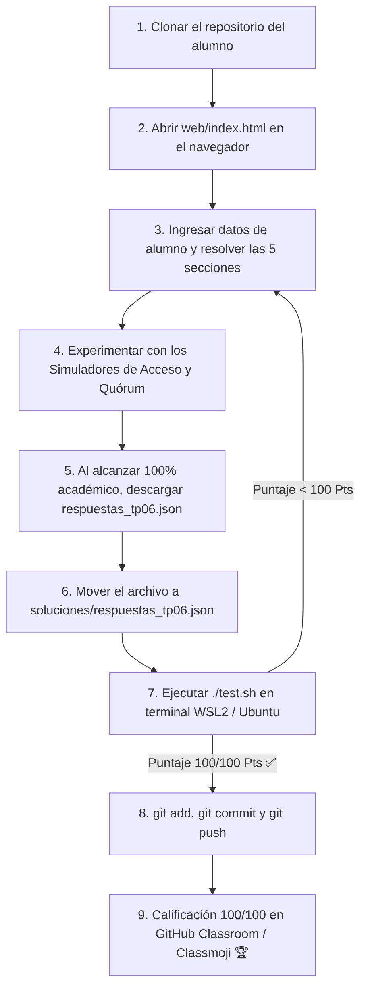

# Trabajo Práctico N° 6: Sistema de Archivos Distribuido (DFS) y RPC

> **Universidad Nacional de Jujuy (UNJu)**  
> **Facultad de Ingeniería — Departamento de Informática**  
> **Cátedra:** Sistemas Operativos II — Ciclo Lectivo 2026  
> **Equipo Docente:** Ing. María Fernanda Vázquez (Titular) | Ing. Fabio Damián Argañaraz Azua (JTP)  
> **Plataformas:** WSL2 (Ubuntu 24.04) | GitHub Classroom | Classmoji  
> **Modalidad:** Individual / Autoevaluativo con Autograding Criptográfico  
> **Estructura Pedagógica:** 100% Laboratorio Web Interactivo con Simuladores de Acceso y Quórum  

---

## 🎯 Objetivos de Aprendizaje

1. **Comprender la Arquitectura de un Sistema de Archivos Distribuido (DFS):** Asimilar la distinción conceptual entre el *Servicio de Archivos* (especificación de primitivas y operaciones visibles para los clientes) y el *Servidor de Archivos* (proceso concreto en espacio de usuario o kernel que implementa el servicio).
2. **Dominar los Esquemas de Nombrado y Niveles de Transparencia:** Analizar la diferencia entre *Transparencia de Ubicación* (el nombre oculta dónde reside físicamente el archivo en la red) e *Independencia de Ubicación* (los archivos pueden migrar dinámicamente de un servidor a otro sin alterar su ruta lógica, ej. AFS) frente a los montajes locales de NFS.
3. **Evaluar Modelos de Acceso a Archivos (Simulador Interactivo):** Comparar el *Modelo de Servicio Remoto (RPC puro)* frente al *Modelo Carga/Descarga (Upload/Download)* midiendo latencias RTT, tiempos de transferencia y tráfico de red para cargas de trabajo específicas (modificación de 1 bloque vs. lecturas intensivas).
4. **Analizar la Coherencia de Caché y Políticas de Actualización:** Comprender el compromiso de ingeniería (*trade-off*) entre fiabilidad y velocidad de *Escritura Directa (Write-Through)* frente a *Escritura Diferida (Write-Back)*, y las técnicas de validación iniciada por el cliente vs. avisos iniciados por el servidor (*Callbacks*).
5. **Diferenciar Servidores con Estado (Stateful) vs. Sin Estado (Stateless):** Identificar cómo el almacenamiento de punteros y tablas de archivos abiertos condiciona la complejidad de recuperación tras caídas del servidor y por qué la idempotencia es obligatoria en servicios sin estado.
6. **Modelar la Replicación de Archivos y el Consenso por Quórum de Gifford:** Aplicar las dos reglas fundamentales de Gifford ($N_r + N_w > N$ y $N_w > N/2$) en un clúster simulado de servidores para prevenir anomalías de lectura-escritura y escrituras concurrentes conflictivas (*split-brain*).
7. **Autoevaluación Criptográfica y Entrega Automatizada:** Ejecutar la suite `./test.sh` y el evaluador Zero-Knowledge `autograder_tp06.py` para validar la calificación (100/100 Pts) antes de enviar a GitHub Classroom.

---

## 📂 Estructura del Repositorio

```text
TP06/
├── .github/
│   └── workflows/
│       └── classroom.yml          # Workflow de CI en GitHub Actions / Classmoji (Python 3.11)
├── soluciones/
│   ├── .gitkeep                   # Mantiene la carpeta en Git
│   └── respuestas_tp06.json.template # Plantilla JSON de referencia
├── web/                           # Módulo Web Interactivo con Simuladores Embebidos
│   ├── index.html                 # Aplicación web con Drag & Drop, switches y tableros
│   ├── styles.css                 # Estilos Glassmorphism en modo oscuro/claro
│   └── app.js                     # Motor de simulación de acceso, quórums y exportación JSON
├── test.sh                        # Suite de validación local (0 a 100 Pts) con diagnóstico
├── autograder_tp06.py              # Evaluador criptográfico en Python 3 (Zero-Knowledge)
├── rubric_tp06.json                # Rúbrica pública con hashes SHA-256 y retroalimentación bibliográfica
├── CHEATSHEET.md                  # Resumen rápido de comandos DFS, NFS, RPC y fórmulas de Gifford
├── .gitattributes                 # Normalización de saltos de línea LF (Unix)
├── .gitignore                     # Exclusión de claves master y temporales de Python
└── README.md                      # Enunciado y guía metodológica paso a paso
```

> [!IMPORTANT]
> **El archivo de entrega es generado por la web:** Al clonar este repositorio, la carpeta `soluciones/` **no contiene** el archivo `respuestas_tp06.json` (solo la plantilla `.template`). Deberá generarlo resolviendo el módulo web interactivo (`web/index.html`).

---

## 🚀 Flujo Metodológico de Trabajo



---

## 🧪 Guía Paso a Paso para la Realización del Trabajo Práctico

### Paso 1: Clonar y verificar el estado inicial de la suite

Abra su terminal en **WSL2 (Ubuntu 24.04)**, ingrese al repositorio clonado y otorgue permisos de ejecución a la suite de pruebas:

```bash
chmod +x test.sh autograder_tp06.py
./test.sh
```

#### Qué debería mostrar por consola (`Salida Inicial 0/100 Pts`):
```text
================================================================
     UNJu — SISTEMAS OPERATIVOS II — EVALUACIÓN AUTOMÁTICA TP 6   
     Tema: Sistema de Archivos Distribuido (DFS) — Módulo Web     
================================================================

Verificando Módulo Web Interactivo (soluciones/respuestas_tp06.json)...
  ✗ Falta el archivo 'soluciones/respuestas_tp06.json'.
  ℹ Pasos para completar el trabajo práctico:
    1. Abra 'web/index.html' en su navegador web preferido.
    2. Ingrese sus datos (Nombre, Legajo, GitHub).
    3. Resuelva los laboratorios interactivos (Simulador de Acceso, Coherencia, RPC y Gifford).
    4. Al alcanzar el 100% académico, haga clic en '📥 Descargar respuestas_tp06.json'.
    5. Mueva el archivo descargado a la carpeta 'soluciones/' de este repositorio.
    6. Vuelva a ejecutar './test.sh'.

  ✗ [FAIL] Módulo Web no entregado (+0 Pts)

================================================================
                       RESUMEN DE CALIFICACIÓN                  
================================================================
  PUNTAJE FINAL: 0 / 100 Pts (0%)
  ESTADO: TP 6 INCOMPLETO — Requiere atención antes de la entrega ⚠️
================================================================
```

#### Explicación pedagógica:
La salida inicial es deliberadamente **0/100 Pts** porque la resolución de este trabajo práctico es 100% interactiva. El sistema le advierte que debe completar el laboratorio web en `web/index.html` para generar el archivo de respuestas criptográfico.

---

### Paso 2: Abrir y resolver el Módulo Web Interactivo

Abra el archivo `web/index.html` en su navegador (Google Chrome, Firefox o Edge). Puede abrirlo directamente con doble clic o ejecutando en terminal:

```bash
# En WSL2:
explorer.exe web/index.html
```

#### Estructura de las Secciones en la Interfaz Web:

1. **Datos del Estudiante:** Ingrese su Apellido y Nombre, Número de Legajo y Usuario de GitHub. *(Nota: Estos campos habilitan la descarga pero no influyen en el contador académico).*
2. **Sección 1: Conceptos Fundamentales de DFS (20 Pts):**
   * 5 tarjetas de selección estructuradas con redacción simétrica sin negritas inductoras.
   * Conceptos clave: Servicio vs. Servidor, rendimiento analítico, independencia de ubicación (AFS), ventajas del modelo RPC y cachés en RAM para estaciones *diskless*.
3. **Sección 2: Matriz de Clasificación Técnica con Switches Segmentados (20 Pts):**
   * 6 selectores binarios de alta precisión (*anti-misspelling*).
   * Clasifique: Esquema NFS (transparencia estática), Write-Through (fiabilidad), Callbacks (iniciada por servidor), servidores Stateless (tolerancia a fallos por idempotencia), replicación retrasada (ventana de inconsistencia) y copia primaria (SPOF).
4. **Sección 3: Laboratorio de Rendimiento: RPC vs. Carga/Descarga (20 Pts):**
   * Configure el **Simulador Interactivo de Acceso** ajustando el tamaño del archivo (1 MB a 200 MB), patrón de trabajo (modificar 1 bloque vs. compilación intensiva) y latencia RTT (1 ms a 90 ms).
   * Observe la animación de paquetes y el tablero comparativo de tiempos y tráfico de red para responder las 4 preguntas analíticas.
5. **Sección 4: Ciclo de Vida RPC de Birrell & Nelson (Drag & Drop) (20 Pts):**
   * Arrastre las 6 etapas canónicas desde el banco de origen hacia las 6 posiciones numeradas para ordenar la secuencia exacta de llamadas entre el cliente, stubs, núcleos y la red.
6. **Sección 5: Laboratorio Matemático y Práctico de Quórum de Gifford (20 Pts):**
   * Manipule los sliders de Quórum de Lectura ($N_r$) y Quórum de Escritura ($N_w$).
   * Observe los indicadores de validez matemática de las dos reglas de Gifford:
     $$\text{Regla 1: } N_r + N_w > N \quad \text{y} \quad \text{Regla 2: } N_w > \frac{N}{2}$$
   * Haga clic en los servidores del clúster ($S_1$ a $S_7$) para simular caídas de nodos y compruebe si se mantiene la consistencia al presionar **"📖 Leer Archivo"** o **"✍️ Escribir Archivo"**. Responda las 4 preguntas técnicas vinculadas.

---

### Paso 3: Exportar `respuestas_tp06.json` y verificar con `./test.sh`

1. Al alcanzar el **100% (25/25 ítems)** en la barra superior fija, se disparará la animación de confetti y se desbloqueará el botón **"📥 Descargar respuestas_tp06.json"**.
2. Guarde o mueva el archivo descargado hacia la carpeta `soluciones/` del repositorio:
   ```bash
   # Ejemplo moviendo desde la carpeta de Descargas de Windows a WSL2:
   mv /mnt/c/Users/<TuUsuario>/Downloads/respuestas_tp06.json soluciones/
   ```
3. Ejecute `./test.sh` en su terminal:

```bash
./test.sh
```

#### Qué debería mostrar por consola (`Salida Final 100/100 Pts`):
```text
================================================================
     UNJu — SISTEMAS OPERATIVOS II — EVALUACIÓN AUTOMÁTICA TP 6   
     Tema: Sistema de Archivos Distribuido (DFS) — Módulo Web     
================================================================

Verificando Módulo Web Interactivo (soluciones/respuestas_tp06.json)...
  ℹ Ejecutando autograder_tp06.py sobre 'soluciones/respuestas_tp06.json'...
========================================================================
  UNJu — FACULTAD DE INGENIERÍA — SISTEMAS OPERATIVOS II (2026)
      EVALUACIÓN AUTOMÁTICA DEL MÓDULO WEB — TRABAJO PRÁCTICO 6
========================================================================
 Estudiante : Gómez, Lucas Matías
 Legajo     : 18240
 GitHub     : lgomez-unju
 Fecha      : 2026-10-28 00:00:25
------------------------------------------------------------------------

✓ [APROBADO] Sección 1: Conceptos Fundamentales de Sistemas de Archivos Distribuidos: 20.0 / 20 Pts
      ✓ q1_definicion_dfs: SERVICIO_ESPECIFICA_SERVIDOR_IMPLEMENTA
      ✓ q2_rendimiento_dfs: ACCESO_DISCO_LATENCIA_RED_COSTO_CPU
      ✓ q3_independencia_ubicacion: PERMITE_MIGRACION_SIN_CAMBIAR_NOMBRE
      ✓ q4_modelo_remoto_vs_carga: EVITA_TRANSFERENCIA_TOTAL_DEL_ARCHIVO
      ✓ q5_ubicacion_cache: SOPORTA_ESTACIONES_SIN_DISCO_Y_MAYOR_VELOCIDAD

✓ [APROBADO] Sección 2: Matriz de Clasificación Técnica con Switches Segmentados: 20.0 / 20 Pts
      ✓ sw1_esquema_nfs: TRANSPARENCIA_ESTATICA_UBICACION
      ✓ sw2_politica_escritura: MAXIMA_FIABILIDAD
      ✓ sw3_semantica_coherencia: INICIO_POR_SERVIDOR
      ✓ sw4_arquitectura_servidor: SERVICIO_STATELESS
      ✓ sw5_riesgo_replica_retrasada: VENTANA_DE_INCONSISTENCIA
      ✓ sw6_replica_primaria_spof: PUNTO_UNICO_DE_FALLO_EN_PRIMARIO

✓ [APROBADO] Sección 3: Laboratorio Interactivo de Modelos de Acceso y Rendimiento: 20.0 / 20 Pts
      ✓ sim_modelo_archivo_grande_pequeno_cambio: SERVICIO_REMOTO_RPC
      ✓ sim_modelo_cargas_intensivas_locales: CARGA_DESCARGA
      ✓ sim_impacto_write_through: BLOQUEO_POR_LATENCIA_RTT_EN_CADA_ESCRITURA
      ✓ sim_tolerancia_fallos_stateless: PETICIONES_AUTOCONTENIDAS_E_IDEMPOTENTES

✓ [APROBADO] Sección 4: Flujo Secuencial del Ciclo RPC de Birrell & Nelson: 20.0 / 20 Pts
      ✓ Etapa 1: 1_CLIENTE_LLAMA_STUB_LOCAL
      ✓ Etapa 2: 2_STUB_CLIENTE_CONSTRUYE_MENSAJE
      ✓ Etapa 3: 3_KERNEL_LOCAL_TRANSMITE_RED
      ✓ Etapa 4: 4_KERNEL_REMOTO_ENTREGA_STUB_SERVIDOR
      ✓ Etapa 5: 5_STUB_SERVIDOR_DESEMPAQUETA_Y_EJECUTA
      ✓ Etapa 6: 6_SERVIDOR_RETORNA_RESULTADO_A_STUB

✓ [APROBADO] Sección 5: Laboratorio Matemático y Práctico de Consenso por Quórum de Gifford: 20.0 / 20 Pts
      ✓ q1_condicion_lectura_escritura: NR_MAS_NW_MAYOR_N
      ✓ q2_condicion_escritura_escritura: NW_MAYOR_N_MEDIOS
      ✓ q3_rowa_escritura_n5: 5
      ✓ q4_mayoria_n7: NR_4_NW_4

========================================================================
 CALIFICACIÓN FINAL DEL MÓDULO WEB: 100.0 / 100 Pts (100.0%)
 ESTADO: ¡FELICITACIONES! Módulo interactivo validado al 100% ✅
========================================================================

  ✓ [PASS] Módulo Web validado al 100% con autograder_tp06.py (+100 Pts)

================================================================
                       RESUMEN DE CALIFICACIÓN                  
================================================================
  PUNTAJE FINAL: 100 / 100 Pts (100%)
  ESTADO: ¡FELICITACIONES! TP 6 COMPLETADO EXITOSAMENTE ✅
================================================================
```

---

### Paso 4: Confirmar y Enviar la Entrega a GitHub Classroom

Una vez obtenido el puntaje **100/100 Pts**, realice el commit y push del archivo `soluciones/respuestas_tp06.json`:

```bash
git status
git add soluciones/respuestas_tp06.json
git commit -m "Entrega Trabajo Práctico N° 6 - 100/100 Pts"
git push origin main
```

El flujo de integración continua (`classroom.yml`) ejecutará automáticamente `./test.sh` en los servidores de GitHub y asignará su calificación con tilde verde ✅ en la plataforma **Classmoji**.
